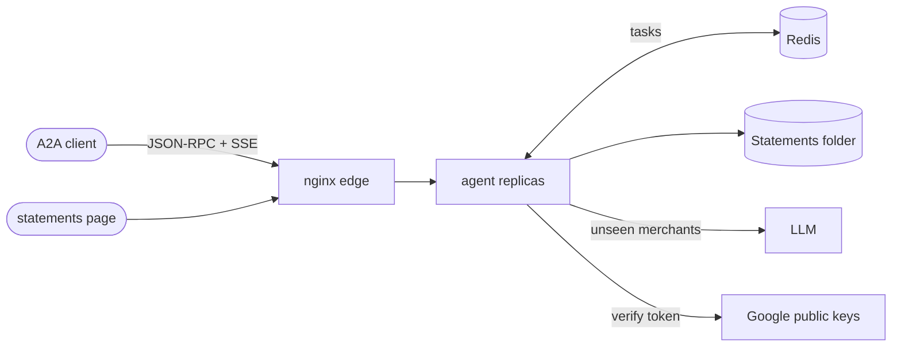

# amex-agent

amex-agent is a service for American Express Israel cards, used by several people and run as
several replicas. Another program asks it, over the open [A2A (Agent2Agent)
protocol](https://a2a-protocol.org), for one person's charges in one billing month and gets them
back categorized. The caller is typically an agent that reviews a household's monthly spending
across cards, such as the author's home finance agent. A2A calls every party in the conversation an
agent, hence the name; inside, amex-agent is a fixed pipeline: read the month's statement,
categorize its merchants, stream the rows back.

**Contents:** [Overview](#overview) · [Tech stack](#tech-stack) · [Architecture](#architecture) ·
[Getting started](#getting-started) · [Scripts](#scripts) · [Details](#details) ·
[License](#license)

## Overview

- A caller asks for a billing month, such as `2026-10`, the month the card is charged (October's
  statement holds the September purchases). It receives every charge of that statement, each with
  its date, amount in shekels, a spending category such as `groceries` or `insurance`, and how
  sure the agent is of it: `high`, `medium` or `low`.
- People download their monthly statement PDFs from the Amex site and load them on a web page of
  the agent, after signing in with their Google account; each person sees and deletes only their
  own files. The agent never logs in to the card site.
- When the month's statement is not loaded yet, the agent pauses the request and names the page
  to load it on; once the person has loaded it, the caller continues the same request.
- A month comes back whole or not at all: the rows are checked against the totals the statement
  prints, and any difference fails the request.
- A language model only chooses categories; every amount and date is read from the PDF.
- Only callers the operator registered are served, each with a secret the agent issued. A caller
  forwards the Google sign-in token its own page received for the person, so the agent knows whose
  statements to read without a password of its own.
- Every card agent offers the same skill, `monthly-transactions`, in one row format that the
  caller defines. Everything Amex-specific (the PDF layout, Hebrew labels, installments, purchases
  abroad) stays here, so a caller needs nothing card-specific.

## Tech stack

- **Service** — Java 21, Spring Boot 4, with a hand-written Spring MVC transport for A2A
- **A2A** — the official a2a-java 1.4 server library, JSON-RPC requests answered as SSE streams
- **Model** — Spring AI with Anthropic or OpenAI, chosen by one setting, to categorize merchants
- **Statements** — Apache PDFBox reads the card site's PDF from a folder per person on disk
- **Auth** — Google ID tokens checked with nimbus-jose-jwt; a secret per registered caller
- **Runtime** — Docker Compose: two replicas behind an nginx edge, sharing tasks through Redis,
  on the workstation or on an EC2 instance behind CloudFront (CloudFormation)
- **Tests** — JUnit unit and integration tests, a Python client-side validation, the official
  A2A conformance suite; GitHub Actions runs them

## Architecture

A caller's request reaches one of the replicas through the nginx edge. The replica checks the
caller's secret and the person's Google token, reads the month's statement from that person's
folder in a statements folder every replica mounts, has a language model categorize the merchants
that replica has not seen yet, and streams the rows back. Tasks live in Redis, so a task paused for
a missing statement can be continued through any replica.

**[Architecture](docs/architecture.md)** continues from here: the full diagram with each part
inside a replica, the boundaries between a card agent and its caller, and a page per subsystem.

## Getting started

The stack runs with Docker Compose, on this machine or on an EC2 instance. It needs Docker, Java
21 with Maven for the tests, and Python 3.11+ with openssl for `tools/validate.sh`.

1. Create a Google OAuth web client of the agent's own, with `http://localhost:8020` as its
   authorized JavaScript origin, for the statements page to sign in with
   ([Sign-in](docs/sign-in.md#setting-up-google) walks the console).
2. Run `./scripts/deploy.sh`. The first run creates the gitignored settings files under
   `scripts/lib/` from their `.example.sh` files, which explain each setting, then stops and
   names each setting left to fill in: the client id as `APP_AUTH_CLIENT_ID` in `params.sh`, and
   the Anthropic or OpenAI key of the model `APP_LLM_MODEL` names as `APP_LLM_API_KEY` in
   `secrets.sh`.
3. Register each caller by its name and the Google client id its own page signs people in with;
   its operator hands you that id. The agent refuses to start without a caller. The command
   prints this agent's name, URLs and the caller's secret, once, to hand to that operator:
   `./scripts/tools/register-caller.sh --name <caller> --client-id <client id>`.
4. Run `./scripts/deploy.sh` again. It builds the images, starts Redis, the replicas and the edge
   on http://localhost:8020, and returns once the agent answers.
5. Load a statement PDF on http://localhost:8020/statements.html; it lands in your own folder
   under `statements/`, which git ignores.
6. Ask for its month from the registered caller: a `SendStreamingMessage` call with the data part
   `{"month": "2026-10"}`, the person's token as the bearer token and the secret in
   `X-Caller-Secret`. `./scripts/tools/validate.sh` makes the same calls against a throwaway
   agent.
7. To run the stack on AWS instead, on an EC2 instance behind a CloudFront distribution of its own,
   run `./scripts/deploy.sh --ec2`: on an instance of its own, or as a guest on another Docker
   Compose repo's instance when `EC2_HOST_STACK` of `params.sh` names that repo's stack. It also
   names the access key pair and region to fill in in `aws-config.sh`, and at the end prints the
   CloudFront address that the card advertises, to hand to the callers' operators and to add to the
   Google client ([Development & deployment](docs/development.md#deployment-scripts-scripts)).

`./scripts/test.sh` runs the tests; none needs a model key, and the Redis integration tests need
Docker. [Development & deployment](docs/development.md) has the details and the gotchas.

## Scripts

- `init-env.sh` — creates the gitignored settings files under `scripts/lib/`; `deploy.sh` runs it
  first
- `test.sh` — checks the scripts, then runs the unit tests (`unit`), or the unit and integration
  tests (the default)
- `deploy.sh` — builds and starts Redis, the replicas and the edge in Docker; `--ec2` does it on
  an EC2 instance behind CloudFront
- `docker-helper.sh` — stops the stack, follows its logs or shows its containers

Each script's header comment is its full documentation, and `--help` prints it. The hands-on
tools are listed in [scripts/tools/README.md](scripts/tools/README.md).

## Details

- [Architecture](docs/architecture.md) — the Compose services, the boundaries, a summary per
  subsystem, the edge on EC2, storage and the codebase
- [API endpoints](docs/api.md) — every route of the agent, who may call it and what it answers
- [Workers' responsibilities and flows](docs/workers.md) — the lease sweep each replica runs
- [A2A contract](docs/a2a-contract.md) — what amex-agent puts on the wire for the shared skill
- [Request flow](docs/architecture/request-flow.md) — a request through the stack and inside a
  replica: the credentials, the transport and its threads
- [Statements](docs/architecture/statements.md) — the folder per person, how the Amex PDF is
  read, and the statements page
- [Categorizer](docs/architecture/categorizer.md) — the merchant keys, the prompt and the
  providers
- [Scaling](docs/architecture/scaling.md) — what the replicas guarantee and the edge service
- [Design patterns](docs/design-patterns.md) — the two halves of the code, the layers of the
  card pipeline and what each package holds
- [Data model](docs/data-model.md) — every Redis key, the statements root, the callers registry
  and the merchant categories
- [Sign-in](docs/sign-in.md) — setting up the Google side of both sign-ins
- [Development & deployment](docs/development.md) — local setup, tests, the scripts, the EC2
  deployment and the gotchas
- [Testing](docs/testing.md) — what each test layer proves, and the latest conformance result
- [Decisions](docs/adr/) — one record per founding decision, with its context and consequences

## License

Source-available under the [PolyForm Noncommercial License 1.0.0](LICENSE). Reading the source,
forking it and running a private deployment are free for anyone, companies included —
[NOTICE](NOTICE) grants that explicitly for evaluating the project or its author. Building a
commercial product or service on it needs a commercial license: erancha@gmail.com.

---
More projects by the author: [github.com/erancha](https://github.com/erancha)
