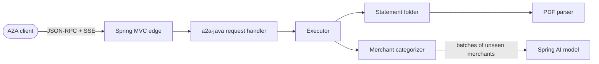

# amex-agent

[](https://github.com/erancha/amex-agent/actions/workflows/ci.yml)

amex-agent is a service for one American Express Israel card. Another program asks it, over the
open [A2A (Agent2Agent) protocol](https://a2a-protocol.org), for one month's card charges and gets
them back categorized. Its partner in this demo is the
[home finance agent](https://github.com/erancha/home-finance-agent), which reviews a household's
monthly spending across cards.

A2A calls every party in the conversation an agent, hence the name. Inside, amex-agent is a fixed
pipeline: read the month's statement, categorize its merchants, stream the rows back.

**Contents:** [Boundaries](#boundaries) · [How a request runs](#how-a-request-runs) ·
[Getting started](#getting-started) · [Scripts](#scripts) · [Testing](#testing) ·
[Architecture](#architecture) · [License](#license)

## Boundaries

- **The contract is shared, not per agent.** Every card agent offers the same A2A skill,
  `monthly-transactions`: a billing month in, rows out in one format (ISO dates, amounts in
  shekels, one category from a closed list), or a request for the missing statement. It is
  specified in [docs/a2a-contract.md](docs/a2a-contract.md).
- **Each card agent normalizes and categorizes its own card.** Everything Amex-specific stops
  here: the PDF layout, Hebrew labels, installments, purchases abroad. Rows leave amex-agent in
  the shared format, each in a category with the agent's confidence, `high`, `medium` or `low`,
  or `uncategorized` when it cannot tell.
- **The home finance agent normalizes nothing card-specific.** It talks to any agent listed in its
  configuration that offers the skill, and owns what spans cards: the person's categories, which
  outrank any card agent's, the budget, the totals and the summary.

## How a request runs

1. The home finance agent reads amex-agent's Agent Card and checks it offers the skill.
2. It asks for a billing month, for example `{"month": "2026-10"}`.
3. amex-agent reads that month's statement PDF from its `statements/` folder and streams the
   charges back in batches, each with a category such as `groceries` or `insurance`.
4. If the PDF is not downloaded yet, amex-agent keeps the task open and asks for it. Once the file
   is in the folder, the home finance agent says "continue" and the same task finishes.

Categories come from a language model (Anthropic or OpenAI). Everything else is read from the
statement, and each section's charges must add up to the total it prints, so a misread statement
fails instead of returning a short month.

## Getting started

Requires **Docker** with Compose 2.24+ for the default run, **Java 21** and **Maven** for tests,
host mode and `validate.sh`, and **Python 3.11+** for `validate.sh`.

```bash
./scripts/init-env.sh          # writes .env with a fresh access token
./scripts/start.sh             # builds the image and starts amex-agent on http://localhost:8020
./scripts/validate.sh          # runs its own copy on :8021 and proves it as an A2A client would
```

Download each monthly statement PDF from the Amex site and load it on the statements page,
**http://localhost:8020/statements.html**, which lists the statements already loaded, deletes one on
request and stores each upload under its billing month whatever the file is called. Copying the file
into `statements/` yourself works too (git ignores the folder). The site names a statement after its
billing month, the month the card is charged: `2026-10.pdf` holds the September purchases charged on
2 October 2026, and answers a request for `2026-10`. The page only loads files; everything about the
month's spending happens in the home finance agent.

The agent needs a language model to run: set `APP_LLM_PROVIDER` (`anthropic` or `openai`),
`APP_LLM_MODEL` and the provider's API key in `.env`; it refuses to start without them. Only the
tests skip the model, through the `e2e` Spring profile, which categorizes with a built-in keyword
table. Every key is explained in [.env.example](.env.example). The scripts treat `.env` as
defaults: a variable already exported in the calling shell wins over the same key there.

## Scripts

All live in `scripts/`; run with `--help` for full usage.

| Script | Purpose |
|---|---|
| `init-env.sh` | Create `.env` and mint the access token; `--token` reuses one, `--force` overwrites. |
| `start.sh` | Run the agent in Docker, or `--host` as a local JVM. |
| `docker-helper.sh` | `--stop`, `--logs [-e]` or `--ps` for the Docker run. |
| `test.sh` | Run unit tests (`unit`) or unit and integration tests (`it`, `all`, the default). |
| `validate.sh` | Start amex-agent against its test statement and prove it end to end as an A2A client; `--tck` also runs the official A2A conformance suite. |
| `anonymize-statement.py` | Copy a statement PDF with the holder's private details replaced, to use as a test fixture. |

## Testing

```bash
./scripts/test.sh              # unit + integration, no Docker, no API key
```
What each layer covers, and the latest conformance result, is in [docs/testing.md](docs/testing.md).

## Architecture



The edge is two Spring controllers around the official a2a-java server library. The card work is a
fixed pipeline: find the statement, parse it, categorize, stream. Details, decisions and the exact
message contract: [docs/architecture.md](docs/architecture.md) and
[docs/a2a-contract.md](docs/a2a-contract.md).

**Stack:** Java 21, Spring Boot, Spring AI, a2a-java, Apache PDFBox, Docker.

## License

Released under the MIT License. See [LICENSE](LICENSE).

---
More projects by the author: [github.com/erancha](https://github.com/erancha)
