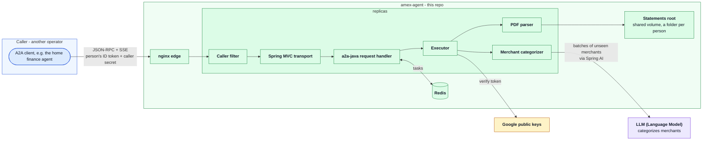

# Architecture

This document details the architecture the [README](../README.md) summarizes. Each section
summarizes its subject and links the topic document holding the detail; each founding decision has a
record under [adr/](adr/). What goes on the wire is in [A2A contract](a2a-contract.md), how to run
the stack in [Development & deployment](development.md), and how each part is tested in
[Testing](testing.md).

**Contents:** [The parts](#the-parts) · [Boundaries](#boundaries) · [Request flow](#request-flow) ·
[Statements](#statements) · [Categorizer](#categorizer) · [Scaling](#scaling) ·
[Configuration](#configuration) · [The edge](#the-edge) ·
[Host or guest on EC2](#host-or-guest-on-ec2) · [Storage](#storage) ·
[Codebase structure](#codebase-structure)

## The parts

Each part is a service of `docker-compose.yml`. Every route is in [API endpoints](api.md), the work
no request waits on in [Workers' responsibilities and flows](workers.md).

- `redis` — Redis 7 with the `amex_redis` volume, holding the A2A tasks the replicas share.
- `amex-agent` — two replicas of the Spring Boot agent, built from the root `Dockerfile`: the A2A
  endpoint, the Agent Card, the statements page and its API. Each mounts the statements root and
  receives the callers registry as a Compose secret, and starts once `redis` is healthy.
- `edge` — nginx, built from `nginx/`: the only service that publishes a port, spreading calls
  over the replicas; it starts once they are healthy.

## Boundaries

- **The contract is shared, not per agent.** Every card agent should offer the same A2A skill,
  `monthly-transactions`: a billing month in, rows out in one format (ISO dates, amounts in
  shekels, one category from a closed list), or a request for the missing statement. The caller
  owns that contract; [A2A contract](a2a-contract.md) describes how amex-agent implements it.
- **Each card agent normalizes and categorizes its own card, so a caller needs nothing
  card-specific.** Everything Amex-specific stops here: the PDF layout, Hebrew labels,
  installments, purchases abroad. Rows leave amex-agent in the shared format, each in a category
  with the agent's confidence, `high`, `medium` or `low`, or `uncategorized` when it cannot tell.
  A caller can talk to any card agent that offers the skill, and owns only what spans cards: the
  person's own categories (which outrank any card agent's), the budget, the totals and the summary.

## Request flow

A caller is known by a secret the agent issued it, and the person by the Google ID token the caller
forwards ([ADR 0004](adr/0004-registered-callers-forward-google-tokens.md)). The transport is
hand-written because the Spring integration of a2a-java refuses streaming requests
([ADR 0001](adr/0001-spring-boot-with-a-hand-written-a2a-transport.md)).
[Request flow](architecture/request-flow.md) walks a request through the stack and inside a replica.

## Statements

One folder per person under the statements root, where a static page lets a person load and
delete their own files. On every lookup the agent reads the folder's PDFs and maps each to the
billing month it declares, so a file loaded while a task waits is found on `continue`. The parser
checks every section against its printed total, so a month comes back whole or not at all. The
person loads each statement; the agent never fetches one from the card site
([ADR 0002](adr/0002-statements-are-pdfs-a-person-loads.md)).
[Statements](architecture/statements.md) has the folder, the PDF and the page.

## Categorizer

A language model only chooses categories, each merchant once, in batches, guided by the sector
label the statement prints, and its score becomes `high`, `medium` or `low` confidence. Amounts and
dates are read from the PDF and never pass through the model, so a model error can mislabel a row
but never change its sum ([ADR 0003](adr/0003-a-model-chooses-categories-only.md)).
[Categorizer](architecture/categorizer.md) has the merchant keys, the prompt and the providers.

## Scaling

The replicas share their A2A tasks through Redis, so a task paused for a missing statement can be
continued through any replica, and outlives the replica that paused it
([ADR 0005](adr/0005-replicas-share-tasks-through-redis.md)).
[Scaling](architecture/scaling.md) has what the replicas guarantee and the mechanisms behind it.

## Configuration

Every runtime setting is an environment variable, which the scripts export from three files under
`scripts/lib/` before they call Compose: the committed `stack-params.sh`, and the gitignored
`params.sh` and `secrets.sh`. Compose hands each replica only the keys the agent reads, and a wrong
required setting stops startup naming it. The files, the keys, the startup checks and the test-only
profiles are in [Development & deployment](development.md#configuration).

## The edge

The `edge` service is the one way in: on the workstation it publishes `EDGE_HOST_PORT` (8020) on
the loopback interface, and on EC2 a CloudFront distribution of the stack's own in front of it
gives the stack the address the card advertises there
([ADR 0006](adr/0006-guest-on-loan-simulators-ec2-instance.md)). How it spreads calls is in
[The edge service](architecture/scaling.md#the-edge-service); what the instance's Compose file
changes and how images reach it in [The EC2 stack](development.md#the-ec2-stack).

## Host or guest on EC2

The instance serves the other Docker Compose repos too: one stack is its host, with the instance
its own, and the others join it as guests, each with its own port and CloudFront distribution
([ADR 0007](adr/0007-any-docker-repo-can-host-the-instance.md)). `EC2_HOST_STACK` of `params.sh`
makes amex-agent's stack either ([The EC2 stack](development.md#the-ec2-stack)).

## Storage

**Redis** holds the tasks and their leases; **the statements root** a folder of statement PDFs per
person; **`allowed-callers.yaml`** the registered callers; and each replica's memory the merchant
categories. Every key, folder and file, and what each holds, is in [Data model](data-model.md).

## Codebase structure

Two halves: the packages that fit a2a-java into Spring and check who is calling, and the card
pipeline in layers ([Design patterns](design-patterns.md#layers-whose-imports-point-inwards)).

- `src/main/java/…/` — the agent, in the packages `a2a`, `auth`, `card/{api,application,infra}`,
  `statements` and `tck`; `src/main/resources/` holds the settings, the test profiles' settings
  and the statements page, `nginx/` the edge's image and configuration.
- `src/test/` — the unit and integration tests and the anonymized test statement.
- `scripts/` — the operational scripts and `common.sh`, which they share
  ([Development & deployment](development.md#deployment-scripts-scripts)).
- `docs/` — this document, the topic documents, `architecture/` for the subsystems, and `adr/`.
- `.github/workflows/` — the CI workflow that runs `scripts/test.sh` and `tools/validate.sh`.
