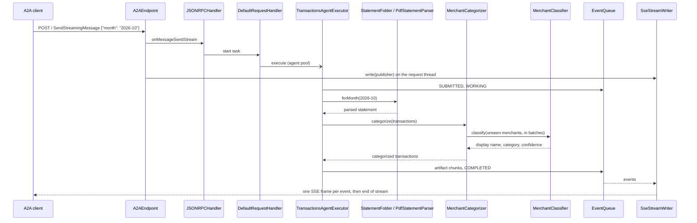

# Architecture

amex-agent is one Spring Boot process with two halves: a Spring MVC transport around the official
a2a-java server library (`a2a/`), and a fixed card pipeline that turns a billing month into
categorized transactions (`card/`). The wire contract is in [a2a-contract.md](a2a-contract.md);
this file explains how the code delivers it.

**Contents:** [Components](#components) · [Request flow](#request-flow) ·
[Why a hand-written Spring transport](#why-a-hand-written-spring-transport) ·
[Threading](#threading) · [Configuration](#configuration) · [Providers](#providers) ·
[Statement folder and layout](#statement-folder-and-layout) ·
[Statements page](#statements-page) · [Categorizer](#categorizer) ·
[Library behavior](#library-behavior)

## Components

Packages under `src/main/java/com/erancha/amexagent/`:

| Package | Classes | Responsibility |
|---|---|---|
| `a2a` | `A2AEndpoint` | `POST /` for every JSON-RPC method: parses the body with the SDK's `JSONRPCUtils`, dispatches over the SDK's sealed request types with an exhaustive `switch`, writes one JSON document or hands a stream to `SseStreamWriter`. A non-JSON content type gets `ContentTypeNotSupportedError` (-32005). |
| `a2a` | `SseStreamWriter` | Subscribes to the handler's event publisher on the request thread, writes and flushes one SSE frame per event, and releases the thread on any failure. |
| `a2a` | `AgentCardEndpoint`, `AgentCardConfiguration` | Serve the public card at `/.well-known/agent-card.json`, built from `app.agent.*` and `app.a2a.auth.*`. |
| `a2a` | `A2AServerConfiguration` | Wires the SDK as Spring beans: in-memory task store, queue manager, main event bus and its processor, the two a2a thread pools, and the `JSONRPCHandler`. |
| `a2a` | `InterruptedStateStreamHook` | A `TaskStreamLifecycleHook` that closes a task's open streams once the task enters an interrupted state such as input-required. |
| `a2a` | `BearerTokenFilter` | Servlet filter for the bearer token, registered only when auth is required. |
| `a2a` | `CallContexts`, `JsonRpcResponses` | Build the SDK's per-request context from the servlet request; serialize non-streaming responses to wire JSON. |
| `a2a` | `SpringJsonRpcTransportMetadata` | ServiceLoader provider (`META-INF/services/org.a2aproject.sdk.server.TransportMetadata`) so the SDK's card validation accepts the JSONRPC interface. |
| `a2a` | `A2AProperties` | The `app.*` configuration tree apart from `app.llm`; its record constructors reject invalid required settings at startup. |
| `card/api` | `Transaction`, `Installment`, `Statement`, `Category`, `Confidence`, `MerchantCategory`, `StatementSource`, `MerchantClassifier` | Domain records, the taxonomy, and the two ports the pipeline depends on. |
| `card/application` | `TransactionsAgentExecutor` | The SDK `AgentExecutor` for the skill: drives submitted, working, artifact chunks, completed, or input-required, and the `continue` resume. |
| `card/application` | `MonthRequest`, `TransactionsService`, `ArtifactMapper` | Validate the request, run the use case, shape transactions into 25-row artifact data parts. |
| `card/application` | `MerchantCategorizer`, `MerchantNormalizer` | Cached, batched categorization keyed by a normalized merchant string. |
| `card/infra` | `StatementFolder`, `StatementParser`, `PdfTextLines`, `PdfStatementParser`, `PdfStatementLayout`, `ExcelStatementParser`, `ExcelStatementLayout`, `HebrewMonths`, `StatementCurrency`, `StatementFormatException` | Index the statement files in a folder by billing month, parse the Amex Israel PDF statement or Excel export, and load a checked upload into the folder. |
| `card/infra` | `SpringAiMerchantClassifier`, `KeywordMerchantClassifier`, `LlmConfiguration`, `LlmProperties` | The two classifier implementations, the choice between them by Spring profile, and the `app.llm` settings. |
| `card/api` | `StatementStore`, `StoredStatement`, `StatementRejectedException` | The port the statements page loads and deletes files through, and its refusal. |
| `card` | `CardConfiguration` | Assembles the pipeline; its executor bean is inactive under the `tck` profile. `StatementFolder` is both the `StatementSource` and the `StatementStore`. |
| `statements` | `StatementsEndpoint`, `static/statements.html` | The statements page and its API: list the loaded files, load one more, delete one. |
| `tck` | `TckAgentExecutor` | The conformance suite's scenario executor, active only under the `tck` profile. |

## Request flow

The executor never writes to the HTTP response. It emits events through the SDK's `AgentEmitter`;
the SDK's main event bus persists each one to the task store and fans it out to the task's queue,
and `SseStreamWriter` turns what the queue yields into frames.

## Why a hand-written Spring transport

The Spring community integration for a2a-java, `spring-ai-a2a`, answers `SendStreamingMessage`
with `UnsupportedOperation`. The skill's whole design is a stream (chunks as they are ready, then
input-required), so the transport here is a small Spring MVC layer over the SDK's
transport-neutral `JSONRPCHandler`.

Rules the transport keeps:

- A2A payloads are parsed and printed by the SDK (Gson and protobuf JsonFormat); controllers take
  and return `String`, so Jackson never touches them.
- `DefaultRequestHandler` is built inside the `jsonRpcHandler` bean rather than exposed as a bean:
  it carries CDI injection annotations that Spring would honour, autowiring a config provider that
  does not exist here and overwriting the builder's settings.
- The SDK's per-task authorization is off; access control is the bearer token at the HTTP edge.
- Push notifications are off on the card and in the handler. The event-bus processor still calls a
  push sender once per streaming event, so it gets a no-op sender.

## Threading

| Thread | Work | Sizing |
|---|---|---|
| Tomcat request thread | Subscribes to the event stream and blocks until it ends, holding the response open. | Tomcat's pool. |
| `a2a-agent-*` | Agent executions and stream conversion. | 5 core threads, up to 50, 60 s keep-alive, queue of 100. A `ThreadPoolExecutor` adds threads past the core only once the queue is full. |
| `a2a-event-consumer-*` | Each open stream has one thread polling its event queue. | Unbounded cached pool. |
| Main event bus processor | Persists events to the task store and distributes them to queues. | One SDK thread. |

The two a2a pools are separate because a consumer thread blocks for the whole life of a stream; in a
shared bounded pool, enough open streams would leave no thread to run the agent that feeds them.
Both are `@Bean(defaultCandidate = false)`, injected by qualifier only, so Spring Boot still
creates its own application task executor.

Servlet output is synchronous and belongs to the request, so the request thread keeps the request
open for as long as the stream lasts. `SseStreamWriter` writes each frame under one lock on the
thread that delivers the event and flushes it at once. A failed write (the client has gone, or a
frame cannot be serialized) or an interrupt of the request thread cancels the upstream
subscription and the SDK's event consumer, and releases the request thread. A disconnect is
noticed at the next frame write.

A task that waits for input must not pin a request thread while a person downloads a file, so
`InterruptedStateStreamHook` closes the task's streams after the input-required event; queued
events are still delivered first.

## Configuration

Every runtime setting in `application.yml` is `${ENV:default}`; secrets, the provider and the
statements folder have no default. [.env.example](../.env.example) explains each one. The rest is
fixed in the file: `app.agent.version` is the Maven project version stamped at build time, the
`spring.ai.model.*` switches other than `chat` keep the unused model types off,
`spring.ai.anthropic.chat.options.max-tokens` is 16384 (see [Providers](#providers)), the actuator
exposes `health` only, `spring.servlet.multipart.*` caps a statements-page upload at 5 MB, and
PDFBox's font warning logger is held at `ERROR`.

| Key | Env | Default | Meaning |
|---|---|---|---|
| `server.port` | `SERVER_PORT` | 8020 | Port the agent listens on. Under Docker only the host port; the container listens on 8020. |
| `app.agent.url` | `APP_AGENT_URL` | `http://localhost:<SERVER_PORT>` | URL published in the card; clients call this one. |
| `app.statements.dir` | `APP_STATEMENTS_DIR` | none, required | Folder of downloaded statements. |
| `app.a2a.auth.required` | `APP_A2A_AUTH_REQUIRED` | true | False removes the filter and the card's security scheme. |
| `app.a2a.auth.token` | `APP_A2A_TOKEN` | none | Bearer token; required when auth is required. |
| `app.llm.provider` | `APP_LLM_PROVIDER` | none, required | `anthropic` or `openai`. |
| `app.llm.model` | `APP_LLM_MODEL` | none, required | Model id. |
| `app.categorizer.high-confidence` | `APP_CATEGORIZER_HIGH_CONFIDENCE` | 0.85 | From this model score up, a row's confidence is `high`. |
| `app.categorizer.medium-confidence` | `APP_CATEGORIZER_MEDIUM_CONFIDENCE` | 0.6 | From this score up it is `medium`; below, `low`. |
| `app.categorizer.batch-size` | `APP_CATEGORIZER_BATCH_SIZE` | 40 | Unseen merchants per classifier call. |
| `spring.ai.anthropic.api-key` | `ANTHROPIC_API_KEY` | none | Required for `anthropic`. |
| `spring.ai.openai.api-key` | `OPENAI_API_KEY` | none | Required for `openai`. |
| `logging.level.com.erancha` | `LOG_LEVEL` | INFO | Agent log level. |
| `logging.level.org.a2aproject.sdk` | `A2A_LOG_LEVEL` | WARN | SDK log level. |

Startup fails, naming the variable, when a required setting is wrong: the `A2AProperties` record
constructors reject a blank `APP_A2A_TOKEN` while auth is required, `LlmProperties` rejects a
provider outside `anthropic | openai` and a missing `APP_LLM_MODEL`, and `LlmConfiguration` rejects
a missing API key for the selected provider. `StatementFolder` refuses to start on a
statements path that is not a directory, naming the path.

The `tck` Spring profile (`application-tck.yml`) turns auth off and swaps the executor; see
[testing.md](testing.md#conformance). The `e2e` profile (`application-e2e.yml`) is for end-to-end
tests only: it replaces the language model with the keyword table, so it needs no provider, model or
key; see [Providers](#providers).

## Providers

| `APP_LLM_PROVIDER` | Classifier | Needs |
|---|---|---|
| `anthropic` | `SpringAiMerchantClassifier` over the Anthropic `ChatModel` | `APP_LLM_MODEL`, `ANTHROPIC_API_KEY` |
| `openai` | `SpringAiMerchantClassifier` over the OpenAI `ChatModel` | `APP_LLM_MODEL`, `OPENAI_API_KEY` |

Every run needs one of them; no setting runs the agent without a language model. The `e2e` Spring
profile alone swaps in `KeywordMerchantClassifier`, a fixed keyword table, so end-to-end tests run
without a model or key. Under it `LlmProperties` is not bound, so `APP_LLM_PROVIDER`,
`APP_LLM_MODEL` and the keys may be unset, and `application-e2e.yml` sets `spring.ai.model.chat`
to `none`.

Both Spring AI starters are on the classpath. `spring.ai.model.chat` mirrors `APP_LLM_PROVIDER`,
so only the selected provider's `ChatModel` auto-configures. Every non-chat model type (embedding,
image, moderation, audio speech and transcription) is set to `none`: the agent uses chat only, and
the OpenAI starter would otherwise create models that need libraries absent from the runtime
classpath.

`SpringAiMerchantClassifier` sends the taxonomy and one batch of raw merchant strings in a single
structured-output call and reads back, per merchant, a display name, a category and a confidence.
Each category carries a guide in `Category` (the kinds of merchants it holds), and the prompt says
a category is what the money buys, not how it is paid: a gym paid by standing order is health, a
streaming service entertainment. It also warns against judging a shop by a generic word in its
name and asks for `uncategorized` over a guess.
Claude may reason before it answers. Spring AI then reports the reasoning as a generation of its
own ahead of the answer, so the classifier reads the last generation, never the first, and
converts its text itself. The reasoning tokens also count against the call's output limit, so
`spring.ai.anthropic.chat.options.max-tokens` is 16384 rather than Spring AI's 4096 default, which
one batch of a few dozen merchants can exhaust. A reply without answer text fails naming the
finish reason and the limit's property instead of handing an empty string to the JSON reader.
The keyword table answers known merchants with confidence 1.0 and everything else as
`uncategorized` at 0.0. It covers the test statement's merchants except its gym, so a test review
always has one merchant for a person to categorize. `validate.sh`, the integration test and the
home finance agent's end-to-end test run under the `e2e` profile to use it.

## Statement folder and layout

`StatementFolder` indexes the files in `APP_STATEMENTS_DIR` by the billing month their content
declares. The card site offers each month as a PDF statement and as an Excel export; both are read,
each by its own `StatementParser`, chosen by extension (`.pdf` or `.xlsx`, in any case):

- Files with other extensions and Excel's `~$` lock files are skipped. Any other file that fails
  to parse fails the lookup with a message that starts with its file name.
- Every lookup rescans the folder, so a file downloaded while a task waits is found on `continue`.
  A file is re-parsed only when its modification time changes.
- Two files for one billing month fail the lookup, naming both files, even when one is the PDF and
  the other the Excel export of the same month: silently preferring one would hide a mismatch.
- A file named like a card-site download, `<YYYY>-<MM>.pdf` or `<last4>_<MM>_<YYYY>.xlsx`, whose
  name and content disagree fails, naming the file and both months. Other names are indexed by
  content alone.

### PDF statement

`PdfTextLines` reads the PDF with PDFBox into lines of text chunks in reading order, each with the
horizontal extent of its non-blank glyphs. `PdfStatementParser` interprets those lines against
`PdfStatementLayout.AMEX_ISRAEL`:

| Element | How it is found |
|---|---|
| Charge date | the line labelled `פרוט פעולותיך לתאריך:`, `DD/MM/YY`; its month is the billing month |
| Sections | `רכישות בחו"ל` (purchases abroad) and `עסקות שחויבו / זוכו - בארץ` (domestic), each from its title line to its `סה"כ חיוב לתאריך` total line; a section continuing on the next page repeats its title there |
| Columns | every column is right-aligned, so a cell belongs to the column whose right edge it ends at, within 4 points; a chunk reaching across a column boundary fails the parse |
| Rows | lines with a `DD/MM/YY` purchase date in the date column; a charge without one fails |
| Domestic row | date, card presence (`ה.קבע` marks a standing order), merchant, sector, purchase amount, charge, and `תשלום N מתוך M` for an installment |
| Abroad row | date, merchant, the original amount with its currency symbol, conversion columns, and the charge in `₪`; the city line under the merchant is skipped |
| Margins | text left of x 130 or right of x 525 is decoration (side banners, page numbers) |

The charges of each section must add up to its printed total, so a row that is lost or misread
fails the parse with both sums instead of quietly shrinking the month. The statement prints no
voucher numbers, so a row's id is the charge date and the row's position, `20261002-01`: stable for
one file and unique across months.

The committed fixture, `src/test/resources/statements/2026-10.pdf` (billing month 2026-10, 24
rows), is a real statement with the holder's name, address, account and card number, the city and a
doctor's name replaced by `scripts/anonymize-statement.py`. The script redraws each replaced word
with its character spacing adjusted to the original width, so text extraction sees the same
columns as in the real file; the mapping of private words to stand-ins never enters the repo.

### Excel export

`ExcelStatementParser` is driven by `ExcelStatementLayout.AMEX_ISRAEL`, which names the sheet, the
anchor cells and every header label, so a changed export fails with a message naming the missing
label or the offending cell instead of producing wrong rows:

| Element | Location in the export |
|---|---|
| Sheet | the single sheet `פירוט עסקאות`, right-to-left, 8 columns |
| Billing month | cell C2: Hebrew month name and year (`אוקטובר 2026`) |
| Card | cell A5: card product name and last four digits |
| Charge date | cell H6: `לחיוב ב-DD.MM`, year taken from the billing month |
| Section header | `עסקאות למועד חיוב` |
| Column headers | `תאריך רכישה`, `שם בית עסק`, `סכום עסקה`, `מטבע עסקה`, `סכום חיוב`, `מטבע חיוב`, `מס' שובר`, `פירוט נוסף`; located by label, not by row number |
| Data rows | until the total row; purchase date as text `DD.MM.YY`, a day the month lacks rejected; amounts numeric; purchase currencies as symbols (`₪`, `$`, `€`, `£`); charge currency always `₪`; voucher as a 9-digit string, used as the row's id |
| Detail column | empty, `הוראת קבע` (standing order), `בוצע בחו"ל` (made abroad), or `תשלום N מתוך M` (installment N of M) |
| Total row | label `סה"כ לחיוב החודש בכרטיס בש"ח`; parsing stops here |
| Trailer | the deferred-charges note and the legal block after the total; ignored |

Every test runs on the PDF statement; the Excel reader has no tests.

## Statements page

`GET /statements.html` is a single static page (plain HTML and JavaScript, no build step) for
loading statement PDFs into `APP_STATEMENTS_DIR` and deleting them. It does nothing else:
reading, categorizing and reviewing a month stay with the A2A skill and the home finance agent.
Its API:

| Request | Answer |
|---|---|
| `GET /api/statements` | The statement files in the folder (the files a lookup would read), sorted by name: `fileName`, `sizeBytes`, `modified`. |
| `POST /api/statements`, multipart part `file` | 201 with the stored file, or a problem document (`application/problem+json`) whose `detail` names the cause: 400 for a refused file, 413 over the `spring.servlet.multipart.max-file-size` limit, 500 when the folder cannot be read or written. |
| `DELETE /api/statements/{fileName}` | 204 once the file is deleted; 400 when no listed statement has that name, so a name never reaches outside the folder or a file that is not a statement. The file is not read first, so a file that blocks the folder (unreadable, misnamed, a second copy of a month) can be removed from the page. |

`StatementFolder.add` refuses, naming the cause, a file that:

- does not start with the PDF signature `%PDF-`;
- does not parse as a statement;
- is for a month another file already covers, or arrives while an unreadable file blocks the folder.

The upload is written to a hidden `.upload-*.part` file in the folder, which no parser claims, and
renamed to the download name of the billing month its content declares, `<YYYY>-<MM>.pdf`, only
after every check passes. The uploaded file's own name only identifies it in refusals, so it can
never place a file outside the folder, and the stored name agrees with the content by construction.
A lookup never sees a partial or refused file. A statement for a month already loaded is not
replaced; remove the old file first.

The page and its API need no token. The bearer token is shared between the two agents and guards
the A2A endpoint only; a person loading a statement is not asked for it. Anyone who can reach the
agent's port can therefore list the folder and add a statement, though not read or replace one.
In Docker the folder is mounted writable and the container runs as the host user who owns it, so
an uploaded file belongs to that user.

A task waiting for a missing statement names the page in its input-required data part (`page`,
the path on the agent's base URL), so a client can link a person straight to it.
`StatementsEndpoint.PAGE` holds that path for both the data part and the token filter's exemption,
and `StatementsEndpoint.API` the API's path for its mapping and the same exemption.

## Categorizer

`MerchantCategorizer` keys every row by `MerchantNormalizer.key(rawMerchant)`: trimmed, whitespace
collapsed, lower-cased, trailing branch numbers and company-form words (`בעמ`, `בע"מ` with either
gershayim spelling, `ltd`, `inc`, `llc`) removed. Keys are cached for the process lifetime. Unseen
keys go to the classifier in batches of `APP_CATEGORIZER_BATCH_SIZE`; `categorize` is
synchronized, so each key is classified once per process and concurrent tasks serialize their
model calls. The model's score in `[0, 1]` becomes the row's confidence, `high`, `medium` or `low`,
by the two thresholds above; a `low` row keeps the model's category as a guess. An answer outside
the taxonomy or the score range becomes `uncategorized` with `low` confidence; a classifier that
answers a different number of merchants than it was asked fails the task.

## Library behavior

- `SendStreamingMessage` is the supported request. The blocking `SendMessage` intermittently
  answers `InternalError` (-32603) `Timeout waiting for task <id> consumption`, even for a task
  that completes in milliseconds: in a2a-java 1.4.0.Final the request's event queue can close
  while the task's last events are still being stored, and the handler waits only 2 seconds for
  them, with no setting to raise it.
- A client that disconnects from a `SubscribeToTask` stream does not stop it early: the SDK
  registers no cancel callback for that method, so its event consumer runs until the task reaches
  a terminal or interrupted state. `SendStreamingMessage` streams stop at the next write.
- Tasks and the categorizer cache live in memory and are lost on restart.
