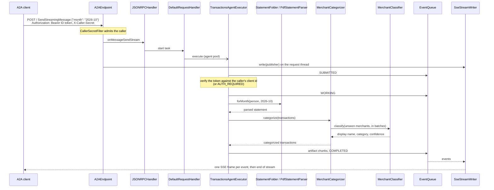

# Architecture

amex-agent is one Spring Boot process with two halves: a Spring MVC transport around the official
a2a-java server library (`a2a/`), and a fixed card pipeline that turns a billing month into
categorized transactions (`card/`). What goes on the wire is in [a2a-contract.md](a2a-contract.md);
this file explains how the code delivers it.

**Contents:** [Components](#components) · [Request flow](#request-flow) ·
[Why a hand-written Spring transport](#why-a-hand-written-spring-transport) ·
[Threading](#threading) · [Configuration](#configuration) · [Who is calling](#who-is-calling) ·
[Providers](#providers) · [Statement folders and layout](#statement-folders-and-layout) ·
[Statements page](#statements-page) · [Categorizer](#categorizer) ·
[Library behavior](#library-behavior)

## Components

Packages under `src/main/java/com/erancha/amexagent/`:

| Package | Classes | Responsibility |
|---|---|---|
| `a2a` | `A2AEndpoint` | `POST /` for every JSON-RPC method: parses the body with the SDK's `JSONRPCUtils`, dispatches over the SDK's sealed request types with an exhaustive `switch`, writes one JSON document or hands a stream to `SseStreamWriter`. A non-JSON content type gets `ContentTypeNotSupportedError` (-32005). |
| `a2a` | `SseStreamWriter` | Subscribes to the handler's event publisher on the request thread, writes and flushes one SSE frame per event, and releases the thread on any failure. |
| `a2a` | `AgentCardEndpoint`, `AgentCardConfiguration` | Serve the public card at `/.well-known/agent-card.json`, built from `app.agent.*` and `app.a2a.auth.*`; with auth on it requires the person's Google ID token (OpenID Connect scheme) and the caller's secret (API key scheme) together. |
| `a2a` | `A2AServerConfiguration` | Wires the SDK as Spring beans: in-memory task store, queue manager, main event bus and its processor, the two a2a thread pools, the caller-secret filter, the user resolver and the `JSONRPCHandler`. |
| `a2a` | `InterruptedStateStreamHook` | A `TaskStreamLifecycleHook` that closes a task's open streams once the task enters an interrupted state such as input-required. |
| `a2a` | `CallerSecretFilter` | Servlet filter admitting a request whose `X-Caller-Secret` names a registered caller, attached to the request for the executor; registered only when auth is required. |
| `a2a` | `CallContexts`, `CallContextUsers`, `JsonRpcResponses` | Build the SDK's per-request context from the servlet request (headers, admitted caller, tenant); resolve the person of an A2A request from that context; serialize non-streaming responses to wire JSON. |
| `auth` | `GoogleTokenVerifier`, `VerifiedUser`, `InvalidTokenException` | Verify a Google ID token (signature against the issuer's keys, issuer, expiry, audience) into the person it names, or a refusal in words for that person. |
| `auth` | `Users`, `UserResolver`, `Caller`, `Callers`, `UserIds` | Which client id a request's token is checked against (the page's own, or the admitted caller's), the registered callers looked up by secret in constant time, and the rule that admits a Google account id as a folder name. |
| `auth` | `AuthProperties`, `AuthConfiguration` | The `app.auth.*` settings and the beans built from them and from the callers list. |
| `a2a` | `SpringJsonRpcTransportMetadata` | ServiceLoader provider (`META-INF/services/org.a2aproject.sdk.server.TransportMetadata`) so the SDK's card validation accepts the JSONRPC interface. |
| `a2a` | `A2AProperties` | The `app.*` configuration tree apart from `app.llm` and `app.auth`; its record constructors reject invalid required settings at startup. |
| `card/api` | `Transaction`, `Installment`, `Statement`, `Category`, `Confidence`, `MerchantCategory`, `StatementSource`, `MerchantClassifier` | Domain records, the taxonomy, and the two ports the pipeline depends on; every statement port takes the person's id. |
| `card/application` | `TransactionsAgentExecutor` | The SDK `AgentExecutor` for the skill: names the person from the forwarded token, then drives submitted, working, artifact chunks, completed, or one of the two pauses (input-required, auth-required) and the `continue` resume by the same person. |
| `card/application` | `MonthRequest`, `TransactionsService`, `ArtifactMapper` | Validate the request, run the use case, shape transactions into 25-row artifact data parts. |
| `card/application` | `MerchantCategorizer`, `MerchantNormalizer` | Cached, batched categorization keyed by a normalized merchant string. |
| `card/infra` | `StatementFolders`, `StatementFolder`, `StatementParser`, `PdfTextLines`, `PdfStatementParser`, `PdfStatementLayout`, `StatementCurrency`, `StatementFormatException` | One folder per person under the statements root; index a folder's statement files by billing month, parse the Amex Israel PDF statement, and load a checked upload into the person's folder. |
| `card/infra` | `SpringAiMerchantClassifier`, `KeywordMerchantClassifier`, `LlmConfiguration`, `LlmProperties`, `LlmModelEnvironmentPostProcessor` | The two classifier implementations, the choice between them by Spring profile, the `app.llm` settings, and the split of `APP_LLM_MODEL` into provider and model before auto-configuration. |
| `card/api` | `StatementStore`, `StoredStatement`, `StatementRejectedException` | The port the statements page loads and deletes files through, and its refusal. |
| `card` | `CardConfiguration` | Assembles the pipeline; its executor bean is inactive under the `tck` profile. `StatementFolders` is both the `StatementSource` and the `StatementStore`. |
| `statements` | `StatementsEndpoint`, `AuthConfigEndpoint`, `static/statements.html` | The statements page and its API: sign in with Google, list the person's loaded files, load one more, delete one; `/api/auth/config` tells the page which Google client to sign in with. |
| `tck` | `TckAgentExecutor` | The conformance suite's scenario executor, active only under the `tck` profile. |

## Request flow

The executor never writes to the HTTP response. It emits events through the SDK's `AgentEmitter`;
the SDK's main event bus persists each one to the task store and fans it out to the task's queue,
and `SseStreamWriter` turns what the queue yields into frames.

## Why a hand-written Spring transport

The Spring community integration for a2a-java, `spring-ai-a2a`, answers `SendStreamingMessage`
with `UnsupportedOperation`. The skill's whole design is a stream (chunks as they are ready, then
input-required), so the transport here is a small Spring MVC layer over the SDK's
transport-neutral `JSONRPCHandler`.

Rules the transport keeps:

- A2A payloads are parsed and printed by the SDK (Gson and protobuf JsonFormat); controllers take
  and return `String`, so Jackson never touches them.
- `DefaultRequestHandler` is built inside the `jsonRpcHandler` bean rather than exposed as a bean:
  it carries CDI injection annotations that Spring would honour, autowiring a config provider that
  does not exist here and overwriting the builder's settings.
- The SDK's per-task authorization is off. The caller is admitted by `CallerSecretFilter` at the
  HTTP edge; the person is verified by the executor, which records them in each pause so a
  `continue` by another person is refused (see [Who is calling](#who-is-calling)).
- Push notifications are off on the card and in the handler. The event-bus processor still calls a
  push sender once per streaming event, so it gets a no-op sender.

## Threading

| Thread | Work | Sizing |
|---|---|---|
| Tomcat request thread | Subscribes to the event stream and blocks until it ends, holding the response open. | Tomcat's pool. |
| `a2a-agent-*` | Agent executions and stream conversion. | 5 core threads, up to 50, 60 s keep-alive, queue of 100. A `ThreadPoolExecutor` adds threads past the core only once the queue is full. |
| `a2a-event-consumer-*` | Each open stream has one thread polling its event queue. | Unbounded cached pool. |
| Main event bus processor | Persists events to the task store and distributes them to queues. | One SDK thread. |

The two a2a pools are separate because a consumer thread blocks for the whole life of a stream; in a
shared bounded pool, enough open streams would leave no thread to run the agent that feeds them.
Both are `@Bean(defaultCandidate = false)`, injected by qualifier only, so Spring Boot still
creates its own application task executor.

Servlet output is synchronous and belongs to the request, so the request thread keeps the request
open for as long as the stream lasts. `SseStreamWriter` writes each frame under one lock on the
thread that delivers the event and flushes it at once. A failed write (the client has gone, or a
frame cannot be serialized) or an interrupt of the request thread cancels the upstream
subscription and the SDK's event consumer, and releases the request thread. A disconnect is
noticed at the next frame write.

A task that waits for input must not pin a request thread while a person downloads a file, so
`InterruptedStateStreamHook` closes the task's streams after the input-required event; queued
events are still delivered first.

## Configuration

Every runtime setting in `application.yml` is `${ENV:default}`; secrets, the provider and the
statements folder have no default. [.env.example](../.env.example) explains each one. The rest is
fixed in the file: `app.agent.version` is the Maven project version stamped at build time, the
`spring.ai.model.*` switches other than `chat` keep the unused model types off,
`spring.ai.anthropic.chat.options.max-tokens` is 16384 (see [Providers](#providers)), the actuator
exposes `health` only, `spring.servlet.multipart.*` caps a statements-page upload at 5 MB, and
PDFBox's font warning logger is held at `ERROR`.

| Key | Env | Default | Meaning |
|---|---|---|---|
| `server.port` | `SERVER_PORT` | 8020 | Port the agent listens on. Under Docker only the host port; the container listens on 8020. |
| `app.agent.url` | `APP_AGENT_URL` | `http://localhost:<SERVER_PORT>` | URL published in the card and called by clients: the one handed to callers' operators (`http://host.docker.internal:8020` for a caller in Docker on this machine). |
| `app.statements.dir` | `APP_STATEMENTS_DIR` | none, required | Folder of downloaded statements. |
| `app.a2a.auth.required` | `APP_A2A_AUTH_REQUIRED` | true | False removes the filter, the token checks and the card's security schemes; everyone is then `anonymous`. |
| `app.a2a.allowed_callers` | file named by `APP_A2A_CALLERS_FILE` | `./allowed-callers.yaml` | The registered callers (`name`, `shared_secret`, `client_id`), imported through `spring.config.import`; at least one is required when auth is required. |
| `app.auth.client-id` | `APP_AUTH_CLIENT_ID` | none | This agent's own Google OAuth client id; the statements page signs in with it. Required when auth is required. |
| `app.auth.issuer` | `APP_AUTH_ISSUER` | `https://accounts.google.com` | Who issues the tokens. |
| `app.auth.jwks-url` | `APP_AUTH_JWKS_URL` | Google's JWKS URL | Where the issuer's public keys are fetched from and cached. |
| `app.auth.public-key-file` | `APP_AUTH_PUBLIC_KEY_FILE` | none | Test only: a PEM public key that replaces the JWKS fetch. |
| `app.llm.model` | `APP_LLM_MODEL` | none, required | `anthropic:<model>` or `openai:<model>`; the provider half selects the ChatModel. |
| `app.categorizer.high-confidence` | `APP_CATEGORIZER_HIGH_CONFIDENCE` | 0.85 | From this model score up, a row's confidence is `high`. |
| `app.categorizer.medium-confidence` | `APP_CATEGORIZER_MEDIUM_CONFIDENCE` | 0.6 | From this score up it is `medium`; below, `low`. |
| `app.categorizer.batch-size` | `APP_CATEGORIZER_BATCH_SIZE` | 40 | Unseen merchants per classifier call. |
| `app.llm.api-key` | `APP_LLM_API_KEY` | none, required | The API key of that provider; both `spring.ai.*.api-key` read it. |
| `logging.level.com.erancha` | `LOG_LEVEL` | INFO | Agent log level. |
| `logging.level.org.a2aproject.sdk` | `A2A_LOG_LEVEL` | WARN | SDK log level. |

Startup fails, naming the variable, when a required setting is wrong: the `A2AProperties` record
constructors reject an empty callers list, an entry with a blank field and two entries sharing a
secret while auth is required, `Users` rejects a blank `APP_AUTH_CLIENT_ID` while auth is required,
`LlmProperties` rejects an `APP_LLM_MODEL` that is blank, not `provider:model`, or names a provider
outside `anthropic | openai`, and `LlmConfiguration` rejects a blank `APP_LLM_API_KEY`.
`StatementFolders` refuses to start on a statements path that is not a directory, naming the path.

The `tck` Spring profile (`application-tck.yml`) turns auth off and swaps the executor; see
[testing.md](testing.md#conformance). The `e2e` profile (`application-e2e.yml`) is for end-to-end
tests only: it replaces the language model with the keyword table, so it needs no provider, model or
key; see [Providers](#providers).

## Who is calling

Every request is for a person, and most arrive through a caller acting for that person. The agent
knows them from two credentials, checked in two places:

- **The caller**, by the shared secret in `X-Caller-Secret`. `CallerSecretFilter` compares it in
  constant time against every registered caller (`Callers.bySecret`) and refuses the request with
  401 when none matches; the matched `Caller` rides on the request into the SDK call context
  (`CallContexts.CALLER_KEY`). Callers are entries of `allowed-callers.yaml`, written by
  `scripts/register-caller.sh`: a name, the secret, and the Google OAuth client id of the caller's
  own sign-in. Registration is the operator adding an entry; removing it revokes the caller.
- **The person**, by the Google ID token in `Authorization`, which the caller forwards exactly as
  the person's browser received it when signing in to the caller's page. `GoogleTokenVerifier`
  checks the RS256 signature against the issuer's published keys (fetched once and cached by
  nimbus-jose-jwt), the issuer, the expiry and the audience, which must equal the admitted
  caller's registered client id (`Users.onBehalfOf`): a token issued to any other client, this
  agent's own included, is refused. The token's `sub` is the person's id everywhere in the agent.

The executor runs the person check itself, after `TASK_STATE_SUBMITTED` and before any work, so a
failed check is a task state the caller can act on (`TASK_STATE_AUTH_REQUIRED` with a
`sign-in-required` data part) rather than an HTTP refusal: the caller has the person sign in again
and continues the same task. Each pause's data part records the person, and a `continue` by
another Google account is answered with `sign-in-required` again. With auth off (the `tck`
profile) neither credential is read and every request is for `anonymous`.

The statements page is the other way in. It signs in with this agent's own Google client
(`APP_AUTH_CLIENT_ID`, set up as [sign-in.md](sign-in.md) describes, read from
`GET /api/auth/config`), and its API verifies the token against that client (`Users.onPage`). The
person uploads into, lists and deletes from the folder of their own `sub`; nobody else's folder
is reachable, and a path-like id is refused by `UserIds` before it becomes a path.

The agent honors a Google token that was issued to a partner's client. That is the trust two
services under one roof place in one identity provider; an agent operated by a separate company
would more likely issue tokens of its own after verifying the person (OAuth 2.0 token exchange).

## Providers

| `APP_LLM_MODEL` | Classifier |
|---|---|
| `anthropic:<model>` | `SpringAiMerchantClassifier` over the Anthropic `ChatModel` |
| `openai:<model>` | `SpringAiMerchantClassifier` over the OpenAI `ChatModel` |

Every run needs one of them with `APP_LLM_API_KEY`, that provider's key; no setting runs the agent
without a language model. The `e2e` Spring profile alone swaps in `KeywordMerchantClassifier`, a
fixed keyword table, so end-to-end tests run without a model or key. Under it `LlmProperties` is not
bound, so `APP_LLM_MODEL` and `APP_LLM_API_KEY` may be unset, and `application-e2e.yml` sets
`spring.ai.model.chat` to `none`.

Both Spring AI starters are on the classpath. `spring.ai.model.chat` is the provider half of
`APP_LLM_MODEL`, which `LlmModelEnvironmentPostProcessor` splits into `app.llm.provider` and
`app.llm.model-id` before auto-configuration runs (a bean would come too late for that), so only the
selected provider's `ChatModel` auto-configures and it is given the model half. Every non-chat model
type (embedding, image, moderation, audio speech and transcription) is set to `none`: the agent uses
chat only, and the OpenAI starter would otherwise create models that need libraries absent from the
runtime classpath.

`SpringAiMerchantClassifier` sends the taxonomy and one batch of raw merchant strings, each beside
the sector label the statement prints for it (`[sector: שרות רפואי]`), in a single
structured-output call and reads back, per merchant, a display name, a category and a confidence.
The sector is the issuer's own hint about what the business does, and the prompt tells the model
to lean on it where the merchant string alone says little, such as a doctor's name billed in
installments. Each category carries a guide in `Category` (the kinds of merchants it holds), and
the prompt says a category is what the money buys, not how it is paid: a gym paid by standing
order is health, a streaming service entertainment. It also warns against judging a shop by a
generic word in its name and asks for `uncategorized` over a guess. A display name keeps the
language the statement prints the merchant in, so a Hebrew merchant is never shown translated to
English. It stays short when the brand explains itself (`Netflix`, `סלקום`) and keeps the words that
say what the business does when it does not (`הראל ביטוח בריאות`), so a row reads as more than a
bare brand.
Claude may reason before it answers. Spring AI then reports the reasoning as a generation of its
own ahead of the answer, so the classifier reads the last generation, never the first, and
converts its text itself. The reasoning tokens also count against the call's output limit, so
`spring.ai.anthropic.chat.options.max-tokens` is 16384 rather than Spring AI's 4096 default, which
one batch of a few dozen merchants can exhaust. A reply without answer text fails naming the
finish reason and the limit's property instead of handing an empty string to the JSON reader.
The keyword table answers known merchants with confidence 1.0 and everything else as
`uncategorized` at 0.0. It covers the test statement's merchants except its gym, so a test review
always has one merchant for a person to categorize. `validate.sh`, the integration test and a
caller's own end-to-end tests run under the `e2e` profile to use it.

## Statement folders and layout

`APP_STATEMENTS_DIR` is a root with one folder per person, named by their Google account id;
`StatementFolders` hands out one `StatementFolder` per person, created by their first upload (a
lookup for a person without a folder is simply empty). `StatementFolder` indexes the files of one
folder by the billing month their content declares. A file with the `.pdf` extension (in any case)
is a statement, read by the `StatementParser` for the card site's PDF statement:

- Files with other extensions are skipped. A `.pdf` file that fails to parse fails the lookup
  with a message that starts with its file name.
- Every lookup rescans the folder, so a file downloaded while a task waits is found on `continue`.
  A file is re-parsed only when its modification time changes.
- Two files for one billing month fail the lookup, naming both files: silently preferring one
  would hide a mismatch.
- A file named like a card-site download, `<YYYY>-<MM>.pdf`, whose name and content disagree
  fails, naming the file and both months. Other names are indexed by content alone.

### PDF statement

`PdfTextLines` reads the PDF with PDFBox into lines of text chunks in reading order, each with the
horizontal extent of its non-blank glyphs. `PdfStatementParser` interprets those lines against
`PdfStatementLayout.AMEX_ISRAEL`:

| Element | How it is found |
|---|---|
| Charge date | the line labelled `פרוט פעולותיך לתאריך:`, `DD/MM/YY`; its month is the billing month |
| Sections | `רכישות בחו"ל` (purchases abroad) and `עסקות שחויבו / זוכו - בארץ` (domestic), each from its title line to its `סה"כ חיוב לתאריך` total line; a section continuing on the next page repeats its title there |
| Columns | every column is right-aligned, so a cell belongs to the column whose right edge it ends at, within 4 points; a chunk reaching across a column boundary fails the parse |
| Rows | lines with a `DD/MM/YY` purchase date in the date column; a charge without one fails |
| Domestic row | date, card presence (`ה.קבע` marks a standing order), merchant, sector (the issuer's label for the business, kept on the row for the categorizer), purchase amount, charge, and `תשלום N מתוך M` for an installment |
| Abroad row | date, merchant, the original amount with its currency symbol, conversion columns, and the charge in `₪`; the city line under the merchant is skipped; the section prints no sector |
| Margins | text left of x 130 or right of x 525 is decoration (side banners, page numbers) |

The charges of each section must add up to its printed total, so a row that is lost or misread
fails the parse with both sums instead of quietly shrinking the month. The statement prints no
voucher numbers, so a row's id is the charge date and the row's position, `20261002-01`: stable for
one file and unique across months.

The committed fixture, `src/test/resources/statements/2026-10.pdf` (billing month 2026-10, 24
rows), is a real statement with the holder's name, address, account and card number, the city and a
doctor's name replaced by `scripts/anonymize-statement.py`. The script redraws each replaced word
with its character spacing adjusted to the original width, so text extraction sees the same
columns as in the real file; the mapping of private words to stand-ins never enters the repo.

## Statements page

`GET /statements.html` is a single static page (plain HTML and JavaScript, no build step) where a
person signs in with Google, loads statement PDFs into their own folder under `APP_STATEMENTS_DIR`
and deletes them. It does nothing else: reading, categorizing and reviewing a month stay with the
A2A skill and its callers. The page reads `GET /api/auth/config` for the client id, loads Google's
sign-in script, keeps the ID token in memory only and sends it as the bearer token of every API
call; a 401 brings the sign-in button back. Once signed in, a header at the top names the person's
account, with a Sign out button that drops the token and returns the page to the sign-in button.
With auth off the page skips sign-in and works on the `anonymous` folder. Its API, each call with
`Authorization: Bearer <ID token>`:

| Request | Answer |
|---|---|
| `GET /api/statements` | The person's statement files (the files a lookup for them would read), sorted by name: `fileName`, `sizeBytes`, `modified`. |
| `POST /api/statements`, multipart part `file` | 201 with the stored file, or a problem document (`application/problem+json`) whose `detail` names the cause: 400 for a refused file, 413 over the `spring.servlet.multipart.max-file-size` limit, 500 when the folder cannot be read or written. |
| `DELETE /api/statements/{fileName}` | 204 once the file is deleted; 400 when no listed statement has that name, so a name never reaches outside the folder or a file that is not a statement. The file is not read first, so a file that blocks the folder (unreadable, misnamed, a second copy of a month) can be removed from the page. |
| any of the above without an acceptable token | 401 with a problem document and `WWW-Authenticate: Bearer`. |

`StatementFolder.add` refuses, naming the cause, a file that:

- does not start with the PDF signature `%PDF-`;
- does not parse as a statement;
- is for a month another file already covers, or arrives while an unreadable file blocks the folder.

The upload is written to a hidden `.upload-*.part` file in the folder, which no parser claims, and
renamed to the download name of the billing month its content declares, `<YYYY>-<MM>.pdf`, only
after every check passes. The uploaded file's own name only identifies it in refusals, so it can
never place a file outside the folder, and the stored name agrees with the content by construction.
A lookup never sees a partial or refused file. A statement for a month already loaded is not
replaced; remove the old file first.

The page and `/api/auth/config` are open; the API takes the person's own token, never a caller's
secret. In Docker the folder is mounted writable and the container runs as the host user who owns
it, so an uploaded file belongs to that user.

A task waiting for a missing statement names the page in its input-required data part (`page`,
the path on the agent's base URL), so a client can link a person straight to it; the person signs
in there with the same Google account and lands in the same folder the task reads.
`StatementsEndpoint.PAGE` holds that path for both the data part and the caller filter's
exemption, and `StatementsEndpoint.API` the API's path for its mapping and the same exemption.

## Categorizer

`MerchantCategorizer` keys every row by `MerchantNormalizer.key(rawMerchant)`: trimmed, whitespace
collapsed, lower-cased, trailing branch numbers and company-form words (`בעמ`, `בע"מ` with either
gershayim spelling, `ltd`, `inc`, `llc`) removed. Keys are cached for the process lifetime. Unseen
keys go to the classifier in batches of `APP_CATEGORIZER_BATCH_SIZE`, each as the raw string and
statement sector of its first row; `categorize` is synchronized, so each key is classified once per
process and concurrent tasks serialize their model calls. The model's score in `[0, 1]` becomes the
row's confidence, `high`, `medium` or `low`, by the two thresholds above; a `low` row keeps the
model's category as a guess. An answer outside the taxonomy or the score range becomes
`uncategorized` with `low` confidence; a classifier that answers a different number of merchants
than it was asked fails the task.

## Library behavior

- `SendStreamingMessage` is the supported request. The blocking `SendMessage` intermittently
  answers `InternalError` (-32603) `Timeout waiting for task <id> consumption`, even for a task
  that completes in milliseconds: in a2a-java 1.4.0.Final the request's event queue can close
  while the task's last events are still being stored, and the handler waits only 2 seconds for
  them, with no setting to raise it.
- A client that disconnects from a `SubscribeToTask` stream does not stop it early: the SDK
  registers no cancel callback for that method, so its event consumer runs until the task reaches
  a terminal or interrupted state. `SendStreamingMessage` streams stop at the next write.
- Tasks and the categorizer cache live in memory and are lost on restart.
