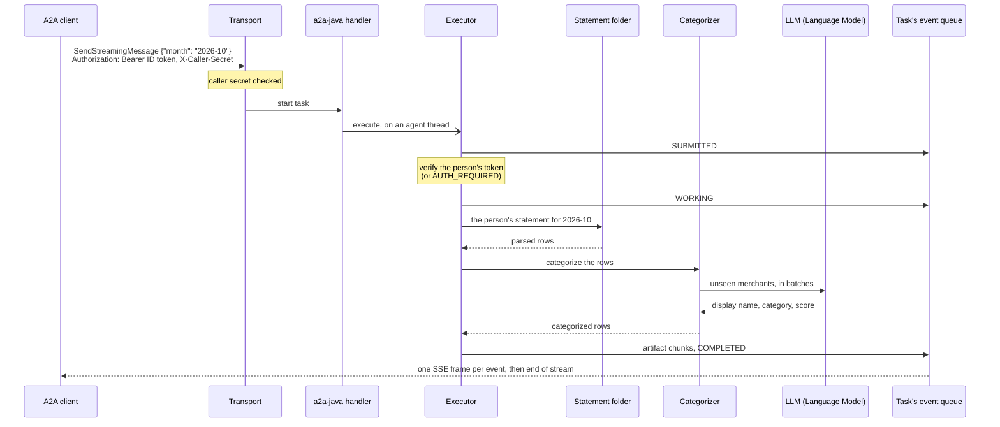

# Request flow

What happens inside one replica between a caller's request for a month and the last row it
receives, and why the agent is built that way.

The executor never writes to the HTTP response. It emits task events; the library stores each one
in the task store and hands it to the task's queue, and the transport turns what the queue yields
into SSE frames. Because every event passes through the task store, a task paused on one replica
can be continued on another ([scaling.md](scaling.md)).

## Who is calling

Every request is for a person, and most arrive through a caller acting for that person. The agent
knows them from two credentials, checked in two places:

- **The caller**, by the shared secret in `X-Caller-Secret`. A filter in front of the transport
  compares it in constant time against every registered caller and answers 401 when none matches.
  Callers are entries in `allowed-callers.yaml`, which `register-caller.sh` writes: a name, the
  secret, and the Google OAuth client id of the caller's own sign-in. Removing an entry revokes the
  caller.
- **The person**, by the Google ID token in `Authorization`, which the caller forwards as the
  person's browser received it. The agent checks the signature against Google's published keys,
  the issuer, the expiry and the audience, which must equal the admitted caller's registered client
  id: a token issued to any other client, this agent's own included, is refused. The token's `sub`
  is the person's id everywhere in the agent.

The executor runs the person check itself, after `TASK_STATE_SUBMITTED` and before any work, so a
failed check is a task state the caller can act on rather than an HTTP refusal: the task pauses in
`TASK_STATE_AUTH_REQUIRED`, the caller has the person sign in again and continues the same task.
Each pause records the person, and a `continue` by another Google account is refused the same way.
With auth off, as under the conformance suite, neither credential is read and every request is for
`anonymous`.

The statements page is the other way in. It signs in with this agent's own Google client
([sign-in.md](../sign-in.md)), and its API accepts only tokens issued to that client. A person
uploads into, lists and deletes from the folder of their own `sub`; nobody else's folder is
reachable, and an id shaped like a path is refused before it becomes one.

The agent honors a Google token that was issued to a partner's client. That is the trust two
services under one roof place in one identity provider; an agent operated by a separate company
would more likely issue tokens of its own after verifying the person (OAuth 2.0 token exchange).

## Why a hand-written Spring transport

The Spring community integration for a2a-java answers `SendStreamingMessage` with
`UnsupportedOperation`. The skill's whole design is a stream, chunks as they are ready and then
possibly a pause, so the transport here is a small Spring MVC layer over the library's
transport-neutral JSON-RPC handler. It leaves A2A payloads to the library's own JSON handling, so
Spring's JSON mapper never reshapes them. The library's per-task authorization is off, because the
caller filter and the executor's person check above already cover it.

## Threads

A stream holds its HTTP request thread open until it ends, since servlet output belongs to the
request. Agent work runs on a separate bounded pool, and each open stream has one more thread
polling its event queue, from a pool of its own: a polling thread blocks for the life of its stream,
so in one shared bounded pool enough open streams would leave no thread to run the agents that feed
them. A failed write, such as a caller that has gone, cancels the stream and releases the request
thread.

A task that waits for a statement must not pin a request thread while a person downloads a file, so
the agent closes a task's streams once it enters an interrupted state, after the queued events are
delivered.

## Library behavior

- `SendStreamingMessage` is the supported request. The blocking `SendMessage` intermittently
  answers `InternalError` (-32603) `Timeout waiting for task <id> consumption`, even for a task
  that completes in milliseconds: in a2a-java 1.4.0.Final the request's event queue can close
  while the task's last events are still being stored, and the handler waits only 2 seconds for
  them, with no setting to raise it.
- A client that disconnects from a `SubscribeToTask` stream does not stop it early: the library
  registers no cancel callback for that method, so the stream runs until the task reaches a
  terminal or interrupted state. A `SendStreamingMessage` stream stops at its next write.
