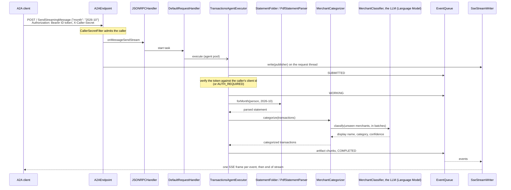

# Request flow

The executor never writes to the HTTP response. It emits events through the SDK's `AgentEmitter`;
the SDK's main event bus persists each one to the task store and fans it out to the task's queue,
and `SseStreamWriter` turns what the queue yields into frames.

## Who is calling

Every request is for a person, and most arrive through a caller acting for that person. The agent
knows them from two credentials, checked in two places:

- **The caller**, by the shared secret in `X-Caller-Secret`. `CallerSecretFilter` compares it in
  constant time against every registered caller (`Callers.bySecret`) and refuses the request with
  401 when none matches; the matched `Caller` rides on the request into the SDK call context
  (`CallContexts.CALLER_KEY`). Callers are entries of `allowed-callers.yaml`, written by
  `scripts/register-caller.sh`: a name, the secret, and the Google OAuth client id of the caller's
  own sign-in. Registration is the operator adding an entry; removing it revokes the caller.
- **The person**, by the Google ID token in `Authorization`, which the caller forwards exactly as
  the person's browser received it when signing in to the caller's page. `GoogleTokenVerifier`
  checks the RS256 signature against the issuer's published keys (fetched once and cached by
  nimbus-jose-jwt), the issuer, the expiry and the audience, which must equal the admitted
  caller's registered client id (`Users.onBehalfOf`): a token issued to any other client, this
  agent's own included, is refused. The token's `sub` is the person's id everywhere in the agent.

The executor runs the person check itself, after `TASK_STATE_SUBMITTED` and before any work, so a
failed check is a task state the caller can act on (`TASK_STATE_AUTH_REQUIRED` with a
`sign-in-required` data part) rather than an HTTP refusal: the caller has the person sign in again
and continues the same task. Each pause's data part records the person, and a `continue` by
another Google account is answered with `sign-in-required` again. With auth off (the `tck`
profile) neither credential is read and every request is for `anonymous`.

The statements page is the other way in. It signs in with this agent's own Google client
(`APP_AUTH_CLIENT_ID`, set up as [sign-in.md](../sign-in.md) describes, read from
`GET /api/auth/config`), and its API verifies the token against that client (`Users.onPage`). The
person uploads into, lists and deletes from the folder of their own `sub`; nobody else's folder
is reachable, and a path-like id is refused by `UserIds` before it becomes a path.

The agent honors a Google token that was issued to a partner's client. That is the trust two
services under one roof place in one identity provider; an agent operated by a separate company
would more likely issue tokens of its own after verifying the person (OAuth 2.0 token exchange).

## Why a hand-written Spring transport

The Spring community integration for a2a-java, `spring-ai-a2a`, answers `SendStreamingMessage`
with `UnsupportedOperation`. The skill's whole design is a stream (chunks as they are ready, then
input-required), so the transport here is a small Spring MVC layer over the SDK's
transport-neutral `JSONRPCHandler`.

Rules the transport keeps:

- A2A payloads are parsed and printed by the SDK (Gson and protobuf JsonFormat); controllers take
  and return `String`, so Jackson never touches them.
- `DefaultRequestHandler` is built inside the `jsonRpcHandler` bean rather than exposed as a bean:
  it carries CDI injection annotations that Spring would honour, autowiring a config provider that
  does not exist here and overwriting the builder's settings.
- The SDK's per-task authorization is off. The caller is admitted by `CallerSecretFilter` at the
  HTTP edge; the person is verified by the executor, which records them in each pause so a
  `continue` by another person is refused (see [Who is calling](#who-is-calling) below).
- Push notifications are off on the card and in the handler. The event-bus processor still calls a
  push sender once per streaming event, so it gets a no-op sender.

## Threading

| Thread | Work | Sizing |
|---|---|---|
| Tomcat request thread | Subscribes to the event stream and blocks until it ends, holding the response open. | Tomcat's pool. |
| `a2a-agent-*` | Agent executions and stream conversion. | 5 core threads, up to 50, 60 s keep-alive, queue of 100. A `ThreadPoolExecutor` adds threads past the core only once the queue is full. |
| `a2a-event-consumer-*` | Each open stream has one thread polling its event queue. | Unbounded cached pool. |
| Main event bus processor | Persists events to the task store and distributes them to queues. | One SDK thread. |

The two a2a pools are separate because a consumer thread blocks for the whole life of a stream; in a
shared bounded pool, enough open streams would leave no thread to run the agent that feeds them.
Both are `@Bean(defaultCandidate = false)`, injected by qualifier only, so Spring Boot still
creates its own application task executor.

Servlet output is synchronous and belongs to the request, so the request thread keeps the request
open for as long as the stream lasts. `SseStreamWriter` writes each frame under one lock on the
thread that delivers the event and flushes it at once. A failed write (the client has gone, or a
frame cannot be serialized) or an interrupt of the request thread cancels the upstream
subscription and the SDK's event consumer, and releases the request thread. A disconnect is
noticed at the next frame write.

A task that waits for input must not pin a request thread while a person downloads a file, so
`InterruptedStateStreamHook` closes the task's streams after the input-required event; queued
events are still delivered first.

## Library behavior

- `SendStreamingMessage` is the supported request. The blocking `SendMessage` intermittently
  answers `InternalError` (-32603) `Timeout waiting for task <id> consumption`, even for a task
  that completes in milliseconds: in a2a-java 1.4.0.Final the request's event queue can close
  while the task's last events are still being stored, and the handler waits only 2 seconds for
  them, with no setting to raise it.
- A client that disconnects from a `SubscribeToTask` stream does not stop it early: the SDK
  registers no cancel callback for that method, so its event consumer runs until the task reaches
  a terminal or interrupted state. `SendStreamingMessage` streams stop at the next write.
- Without Redis, tasks are kept in the process's memory and are lost when it restarts. The
  categorizer cache is always kept in the process's memory.
